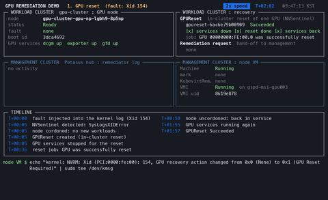
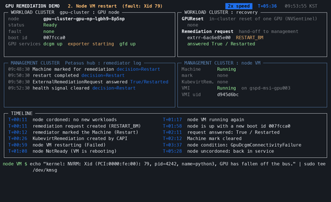
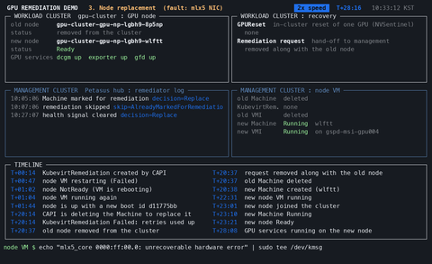

# nvsentinel-capi-remediator

[](https://github.com/petasus-ai/nvsentinel-capi-remediator/actions/workflows/verify.yml)
[](https://github.com/petasus-ai/nvsentinel-capi-remediator/releases/latest)
[](LICENSE)

Turns [NVSentinel](https://github.com/NVIDIA/NVSentinel) GPU fault signals
into [Cluster API](https://cluster-api.sigs.k8s.io/) Machine remediation.

NVSentinel detects GPU and fabric faults inside a workload cluster and
recommends an action for each one, such as restarting or replacing the node.
The Cluster API `Machine` that can carry out a restart or a replacement lives
in the management cluster, where NVSentinel does not look. This operator
connects the two. It runs in the management cluster, reads NVSentinel's
signals from every workload cluster, and asks Cluster API to restart or
replace the Machine behind a faulty node. It uses only contracts that
Cluster API defines for every infrastructure provider.

It is meant for platforms that run GPU workload clusters with Cluster API and
NVSentinel, and want a GPU fault to end in a restarted or replaced node
without someone acting on each one.

## Demo

Click a recording to watch it.

<table>
<tr>
<td align="center" valign="top" width="33%">
<a href="docs/images/gpu-reset.gif">

<br/><b>GPU reset</b>
</a>
<br/>NVSentinel resets the GPU in place. The operator is not involved.
</td>
<td align="center" valign="top" width="33%">
<a href="docs/images/gpu-vm-restart.gif">

<br/><b>Node restart</b>
</a>
<br/>The operator marks the Machine, and the provider's remediation restarts the node.
</td>
<td align="center" valign="top" width="33%">
<a href="docs/images/gpu-node-replace.gif">

<br/><b>Node replacement</b>
</a>
<br/>The operator marks the Machine for a replacement. The provider's remediation tries a restart first, then Cluster API replaces the Machine.
</td>
</tr>
</table>

## How it works

1. **Read.** The operator reaches each workload cluster through the
   kubeconfig Cluster API keeps for it, and reads NVSentinel's signals:
   `ExternalRemediationRequest` objects where the cluster serves that
   resource, node conditions where NVSentinel only detects faults.
2. **Decide.** It maps NVSentinel's recommended action to a decision:
   Replace, Restart or Report.
3. **Act.** For a Replace or a Restart it marks the node's Machine with
   Cluster API's `cluster.x-k8s.io/remediate-machine` annotation. The
   MachineHealthChecks that select the Machine then carry out the
   remediation.
4. **Follow up.** Once a restart is over, the operator answers the
   `ExternalRemediationRequest` it came from, if any, and removes its mark.

| NVSentinel recommends | Decision | What happens |
|---|---|---|
| `REPLACE_VM` | Replace | The MachineHealthChecks remediate the Machine, which ends in a replacement. |
| `RESTART_VM`, `RESTART_BM` | Restart | The infrastructure provider's remediation restarts the Machine. This needs MachineHealthChecks with a remediation template. |
| anything else | Report | Nothing is changed. The operator logs the signal and records an Event. |

The table can be changed; see [Decisions](docs/configuration.md#decisions).
[docs/design.md](docs/design.md) describes each step in detail.

## Requirements

- A management cluster whose Cluster API serves `cluster.x-k8s.io/v1beta2`
  (v1.11 or later).
- NVSentinel in the GPU workload clusters. Its default install, which only
  detects faults, is enough to start with; [docs/nvsentinel.md](docs/nvsentinel.md)
  describes the other ways to deploy it.
- MachineHealthChecks that select the GPU worker Machines. Without one, the
  operator only reports. Restarts also need a remediation template from the
  infrastructure provider; see [docs/machinehealthchecks.md](docs/machinehealthchecks.md).
- Network access from the management cluster to each workload cluster's API
  server, the same access Cluster API itself uses.
- Permission to read Secrets in every namespace of the management cluster,
  for the kubeconfig Secret of each workload cluster; see
  [Permissions](docs/configuration.md#permissions).

## Quick start

Install the latest release in dry-run mode, the default, in which the
operator logs what it would do and changes nothing. The selector limits it to
the Clusters you label. If NVSentinel in that cluster already hands nodes
over through `ExternalRemediationRequest`, read
[Before you route actions to requests](docs/getting-started.md#before-you-route-actions-to-requests)
first.

```sh
helm install nvsentinel-capi-remediator nvsentinel-capi-remediator \
  --repo https://raw.githubusercontent.com/petasus-ai/edgestack-helm/master/ \
  --namespace nvsentinel-capi-remediator-system --create-namespace \
  --set clusterSelector=nvsentinel-remediation=enabled

kubectl -n <cluster-namespace> label clusters.cluster.x-k8s.io <cluster> nvsentinel-remediation=enabled
kubectl -n nvsentinel-capi-remediator-system logs deploy/nvsentinel-capi-remediator -f
```

Each labeled cluster logs `signal source selected` once it is read, and each
fault NVSentinel reports there logs the decision the operator would take.
[docs/getting-started.md](docs/getting-started.md) explains what to look for,
how to try it with a test signal, and how to turn remediation on.

Without Helm, apply the release's manifests. They install the operator in
dry-run mode into `nvsentinel-capi-remediator-system`, without a cluster
selector:

```sh
kubectl apply -f https://github.com/petasus-ai/nvsentinel-capi-remediator/releases/latest/download/install.yaml
```

## Safeguards

- Dry-run mode is the default: the operator writes nothing until you turn it
  off. NVSentinel still acts: where it hands nodes over through
  `ExternalRemediationRequest`, it has cordoned and drained a node before the
  operator sees it, and in dry-run mode nobody answers; see
  [getting started](docs/getting-started.md#before-you-route-actions-to-requests).
- Control plane Machines are never remediated.
- A Machine that is being deleted, already marked, paused, or opted out with
  `cluster.x-k8s.io/skip-remediation` is not marked. A restart mark set on it
  earlier can still become a replacement mark; see
  [Escalation](docs/design.md#escalation).
- Every action leaves a Kubernetes Event on the Machine, because the Machine
  and its annotations are gone once it is replaced.

## Documentation

| Page | Covers |
|---|---|
| [Getting started](docs/getting-started.md) | Checking the requirements, installing in dry-run mode, a test signal, turning remediation on |
| [MachineHealthChecks](docs/machinehealthchecks.md) | What the MachineHealthChecks need for replacements and for restarts |
| [NVSentinel](docs/nvsentinel.md) | Ways to deploy NVSentinel, routing actions to requests, GPU resets |
| [Configuration](docs/configuration.md) | Settings, chart values, annotations, the decision table, permissions |
| [Operations](docs/operations.md) | Events, answers to requests, undoing a mark, upgrading, uninstalling, troubleshooting |
| [Design](docs/design.md) | How each step works, and why |
| [Releasing](docs/releasing.md) | For maintainers: cutting a release |

## Status

The operator is young. It has run end to end on one infrastructure provider,
with Cluster API v1.13 and NVSentinel v1.23 and v1.26. Flags and chart values
may still change between minor versions.

Open work, labeled
[help wanted](https://github.com/petasus-ai/nvsentinel-capi-remediator/issues?q=is%3Aissue%20is%3Aopen%20label%3A%22help%20wanted%22):

- [#13](https://github.com/petasus-ai/nvsentinel-capi-remediator/issues/13)
  Verify the restart path and the control plane guard with more providers.
- [#12](https://github.com/petasus-ai/nvsentinel-capi-remediator/issues/12)
  Run Cluster API's MachineHealthCheck reconciler in the integration tests.
- [#11](https://github.com/petasus-ai/nvsentinel-capi-remediator/issues/11)
  Fewer live reads when many requests are pending in one cluster.

## Contributing

Contributions are welcome. [CONTRIBUTING.md](CONTRIBUTING.md) describes how
to build and test the operator and how changes are made; every commit needs
a Developer Certificate of Origin sign-off (`git commit -s`). Everyone taking
part follows the [Code of Conduct](CODE_OF_CONDUCT.md). Report security
problems as [SECURITY.md](SECURITY.md) describes.

## License

Apache License 2.0. See [LICENSE](LICENSE) and [NOTICE](NOTICE).
